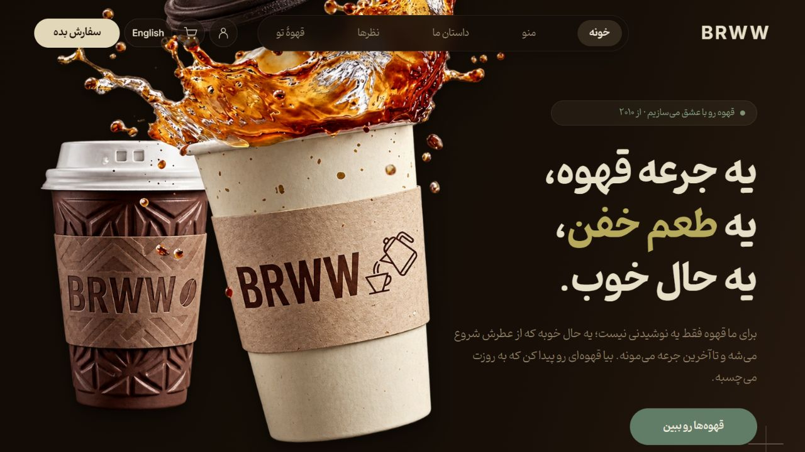
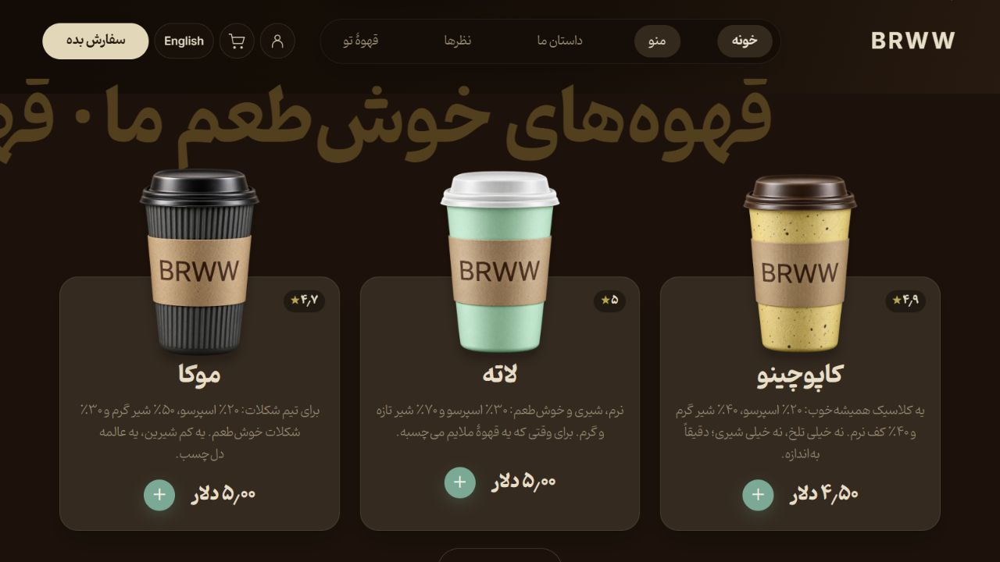
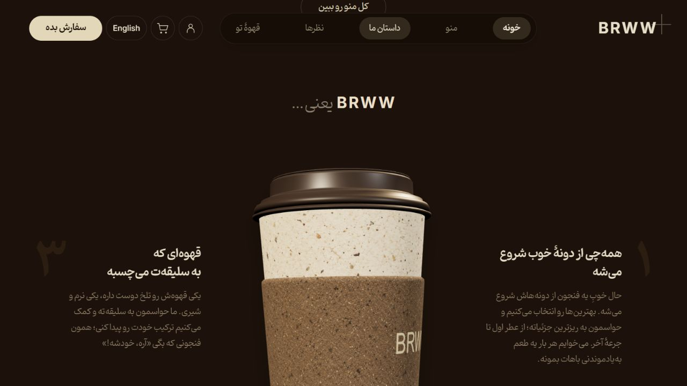
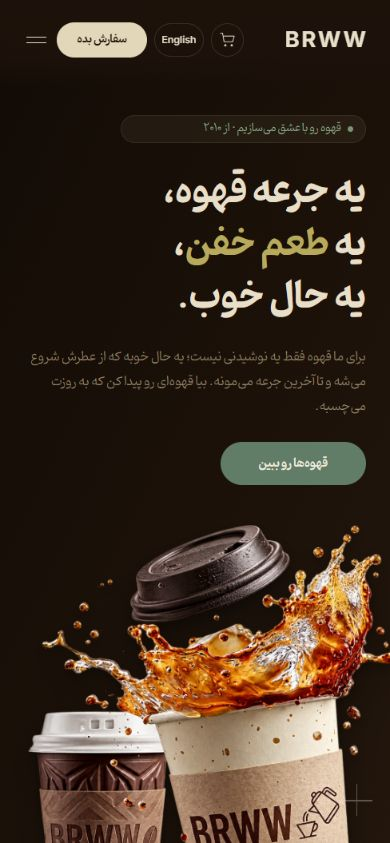

<p align="center"></p>

<div dir="rtl">

# BRWW — Coffee in Motion

یک تجربهٔ تعاملی قهوه با بافت‌های گرم، لیوان سه‌بعدی و حرکت‌های آرام؛ نمونه‌کاری از **[سجاد دهقان](https://github.com/sajjad-dehghan)** برای تبدیل یک مرجع بصری به یک وب‌سایت واقعی و واکنش‌گرا.

**[مشاهدهٔ دموی آنلاین](https://sajjad-dehghan.github.io/brww-coffee-in-motion/)** · **[English README](README.md)**



## فارسی، با حال‌وهوای خودمونی

سایت به‌صورت پیش‌فرض فارسی است؛ با فونت محلی پینار، چیدمان راست‌به‌چپ، اعداد فارسی و ترجمهٔ همهٔ بخش‌ها، سبد خرید و تست انتخاب قهوه. دکمهٔ زبان بالای صفحه، نسخهٔ انگلیسی را بدون بارگذاری دوباره باز می‌کند و سبد خرید حفظ می‌شود. انتخاب زبان هم روی همین مرورگر ذخیره می‌شود.

**[نسخهٔ فارسی](https://sajjad-dehghan.github.io/brww-coffee-in-motion/?lang=fa)** · **[نسخهٔ انگلیسی](https://sajjad-dehghan.github.io/brww-coffee-in-motion/?lang=en)**

## در این پروژه چه پیاده‌سازی شده؟

- لیوان‌های بخش اصلی با حرکت نشانگر، کمی از پس‌زمینه فاصله می‌گیرند و سایه و زاویهٔ آن‌ها تغییر می‌کند. حرکت فقط روی بخش‌های واقعی تصویر فعال است.
- لیوان میانی یک مدل قابل ویرایش با هفت قطعه در Three.js است؛ با جنس کاغذ، روکش کرافت و نورپردازی گرم. چرخش آن خودکار است و به اسکرول وابسته نیست.
- متن‌های کنار لیوان، در دو ردیف مستقل، با ورود به محدودهٔ دید محو و جابه‌جا می‌شوند.
- قاشق و دانه‌های قهوه یک حرکت هماهنگ با چرخهٔ حدود سه‌ونیم ثانیه دارند.
- سبد خرید، تغییر تعداد، محاسبهٔ قیمت، ذخیرهٔ محلی ترجیحات و تست سه‌مرحله‌ای انتخاب قهوه کار می‌کنند.
- چیدمان موبایل، دیالوگ‌های بومی، بستن با کلید Escape و پشتیبانی از کاهش حرکت در نظر گرفته شده‌اند.

## حرکت‌ها در عمل

این تصاویر متحرک از اجرای واقعی نسخهٔ انگلیسی پروژه ضبط شده‌اند. حرکت‌ها در هر دو زبان یکسان‌اند. برای دیدن کیفیت کامل، دموی آنلاین را باز کنید.


## جزئیات بصری



<p align="center"> </p>

## مسیر ساخت

مرجع بصری این پروژه، پیش‌نمایش عمومی **[قالب Coffee از Scrolltide](https://www.scrolltide.co/templates/coffee)** است. حرکت‌ها از بخش‌هایی از ویدئو بررسی و اندازه‌گیری شدند؛ سپس ساختار صفحه، مدل سه‌بعدی و تعامل‌ها پیاده‌سازی و در مرورگر بررسی شدند.

تصاویر اصلی، تصاویر محصولات، قاشق و بافت‌های مدل با کمک تولید تصویر بازسازی شده‌اند. فایل‌های باکیفیت و پرامپت‌ها در [artwork/v2](artwork/v2) و شواهد بررسی در [verification](verification) قرار دارند. توسعه و تولید دارایی‌ها با کمک Codex و ImageGen انجام شده است.

فایل اصلی طراحی یا سورس قالب در اختیار نبود؛ این پروژه بازسازی از روی مرجع است و ادعای تطابق پیکسلی کامل ندارد. ترکیب‌بندی موبایل برای همین پیاده‌سازی تنظیم شده است.

## ساختار فنی و اجرا

HTML، CSS و JavaScript بدون فریم‌ورک، همراه با Three.js محلی. فایل‌های آمادهٔ انتشار در `dist/` هستند و برای اجرای سایت نیازی به نصب پکیج یا مرحلهٔ بیلد نیست. Node.js نسخهٔ ۲۰ یا بالاتر کافی است.

</div>

```bash
git clone https://github.com/sajjad-dehghan/brww-coffee-in-motion.git
cd brww-coffee-in-motion
npm run dev
```

<div dir="rtl">

سایت در **http://127.0.0.1:5188/** باز می‌شود. دستور `npm run check` بررسی نحوی فایل‌های JavaScript و تست‌های منطق سبد خرید و ترجمه‌ها را اجرا می‌کند. فارسی و انگلیسی در دسکتاپ و موبایل، تا عرض ۳۲۰ پیکسل، بررسی شده‌اند. قیمت‌ها در هر دو زبان همان مقدار اصلی دلار هستند.

اگر WebGL در دسترس نباشد، همان مدل با ویدئوی H.264، سپس WebP متحرک و در نهایت تصویر ثابت نمایش داده می‌شود. برای بررسی مسیر ویدئو، آدرس `/?cup-renderer=image#about` و برای WebP آدرس `/?cup-renderer=webp#about` را باز کنید.

## محدودهٔ نمونه‌کار

سبد خرید و ترجیحات در مرورگر ذخیره می‌شوند؛ پرداخت، ثبت سفارش واقعی و سرویس حساب کاربری متصل نیستند. بررسی‌های ثبت‌شده، چیدمان دسکتاپ و موبایل، حرکت‌ها، دیالوگ‌ها و مسیرهای جایگزین نمایش لیوان را پوشش می‌دهند. فایرفاکس بومی و شبیه‌سازی تنظیم کاهش حرکت سیستم‌عامل برای آزمون مستقیم در دسترس نبودند.

فونت پینار از فایل‌های محلی موجود صاحب پروژه اضافه شده است؛ [یادداشت منبع](dist/assets/pinar/SOURCE.txt). مجوز فونت‌های دیگر شامل پینار نمی‌شود.

حقوق طراحی مرجع متعلق به صاحبان آن است. مجوز Three.js در [این فایل](dist/vendor/THREE-LICENSE.txt) و مجوز فونت‌های [Inter](dist/assets/INTER-OFL.txt) و [Playfair Display](dist/assets/PLAYFAIR-OFL.txt) نگهداری شده است.

</div>
