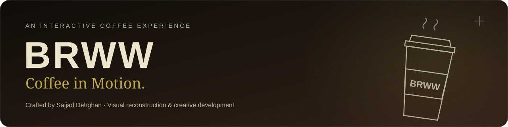
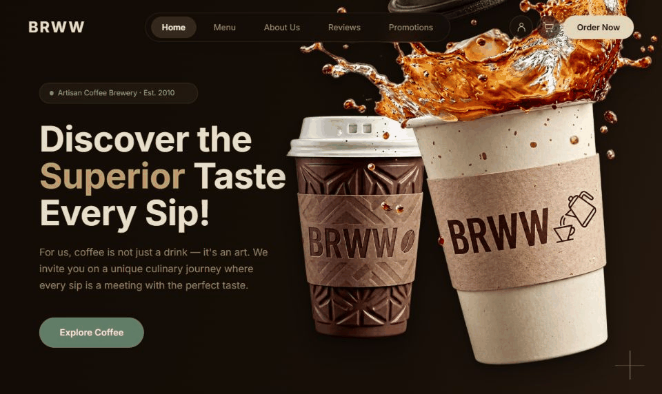
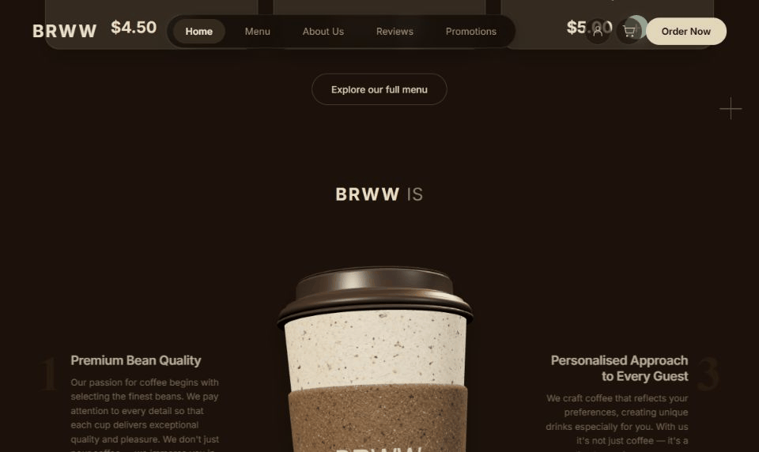
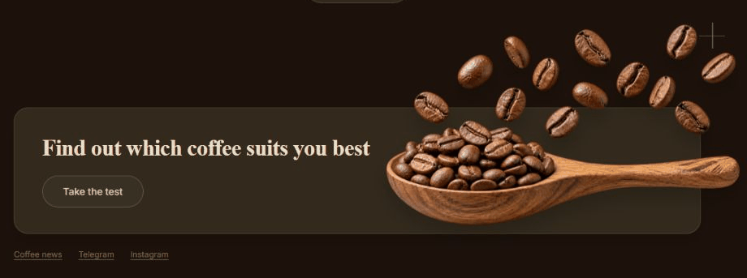
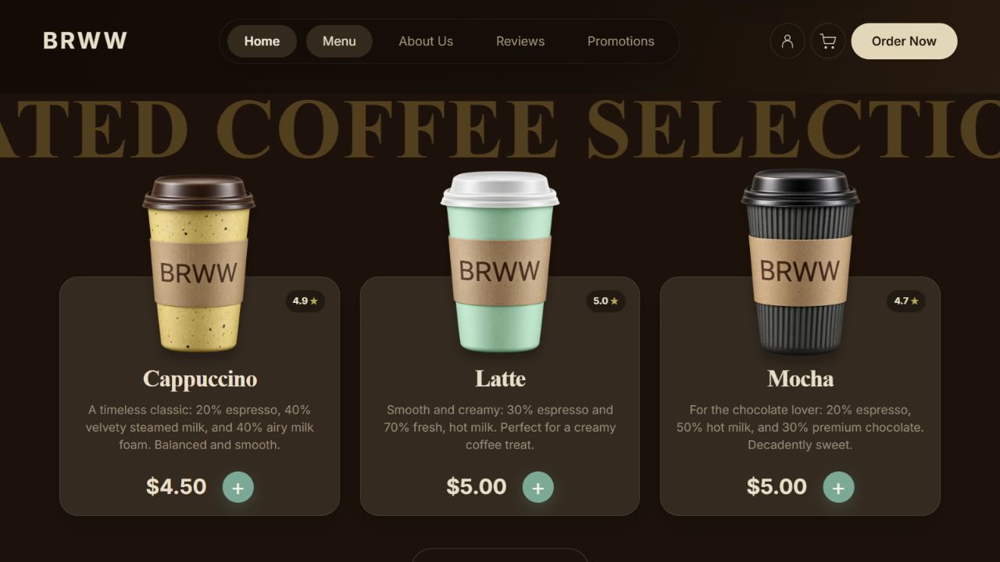
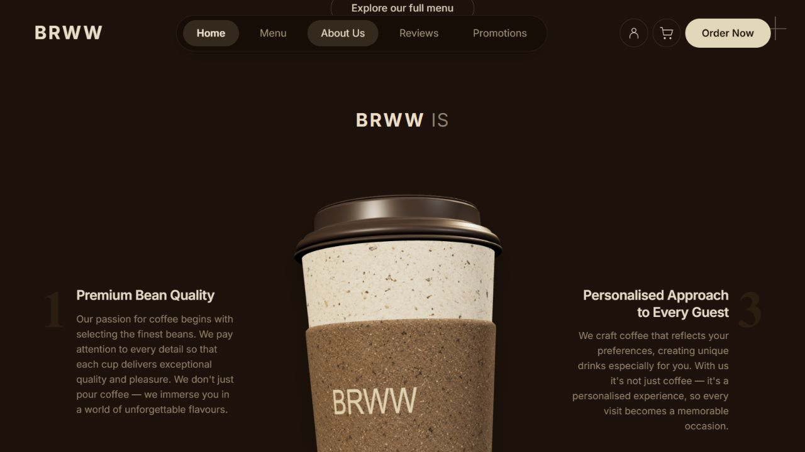
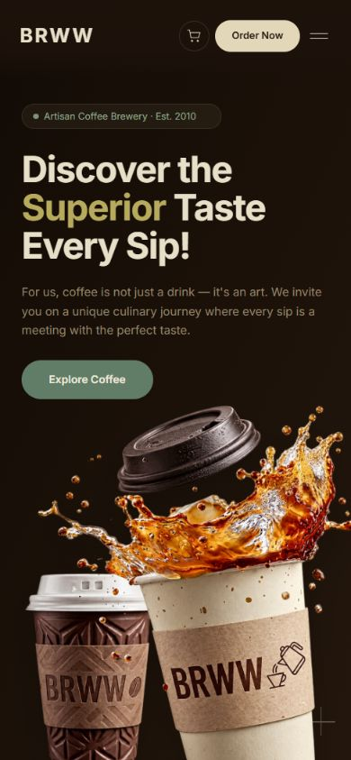
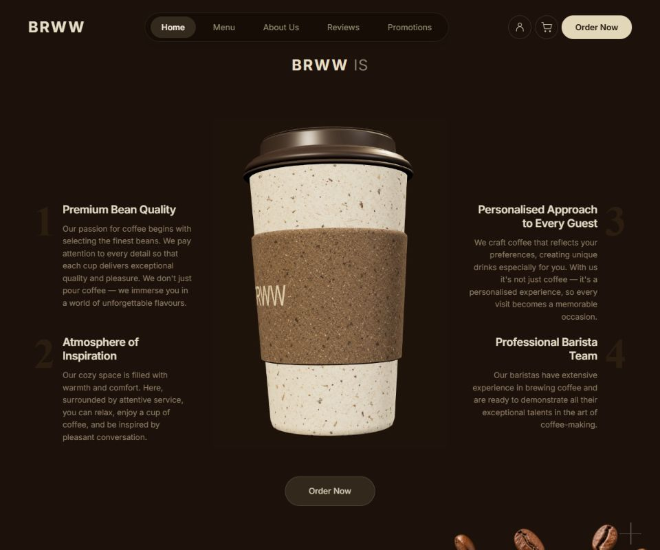

<p align="center">
  
</p>

<p align="center">
  <a href="https://sajjad-dehghan.github.io/brww-coffee-in-motion/"><strong>Explore the live experience ↗</strong></a>
  &nbsp; · &nbsp; <a href="#motion-studies">Motion studies</a>
  &nbsp; · &nbsp; <a href="#run-locally">Run locally</a>
  &nbsp; · &nbsp; <a href="README.fa.md">فارسی</a>
</p>

<p align="center">
  
  
  
  <a href="https://github.com/sajjad-dehghan/brww-coffee-in-motion/actions/workflows/pages.yml"></a>
</p>

A warm, cinematic coffee storefront with tactile artwork, an automatically turning 3D cup, and carefully paced motion. A portfolio project by **[Sajjad Dehghan](https://github.com/sajjad-dehghan)** exploring how a visual reference becomes a working, responsive web experience.


## The experience

- **Tactile hero artwork.** Alpha-aware pointer detection gives the cups a gentle perspective lift and soft shadows, without moving the headline or navigation.
- **A real 3D cup.** A seven-part editable Three.js model, textured paper and kraft materials, warm lighting, and a smooth 14-second automatic turn independent of scrolling.
- **Scroll entrances.** The copy beside the cup fades and slides inward as each row reaches the viewport.
- **Floating coffee.** The spoon and airborne beans share a measured 3.5-second loop.
- **Working local interactions.** A shopping bag with quantities and persistent state, integer-cent totals, a three-step coffee quiz, and saved preferences.
- **Responsive composition.** Desktop and mobile layouts, native dialogs, keyboard dismissal, a skip link, and reduced-motion handling.

## Motion studies

These GIFs are recordings of the implemented page. The effects are deliberately subtle; the [live demo](https://sajjad-dehghan.github.io/brww-coffee-in-motion/) shows the full rendering quality.

### 01 / Depth under the pointer

Only opaque artwork activates the lift. Empty image margins and navigation controls stay quiet; leaving the artwork smoothly returns it to rest.



### 02 / Copy enters, the cup keeps turning

The text follows viewport visibility while the model follows time. Each feature row enters independently.



### 03 / A slow coffee float

The spoon and beans move together, with a soft rise and fall that continues without scrolling.



## A closer look



<p align="center">
  
  &nbsp;
  
</p>

<details>
<summary><strong>See the pre-rendered cup fallback</strong></summary>



When WebGL is unavailable, the page uses a 680 × 960, 30 fps H.264 rendering of the same model. Animated WebP is the next fallback; a sharp poster is used for reduced motion. Motion pauses outside the viewport and in hidden tabs.

</details>

## From reference to implementation

The visual direction is based on **[Scrolltide's Coffee template preview](https://www.scrolltide.co/templates/coffee)**. I studied the publicly visible recording, measured motion in selected frames, reconstructed the page, and iterated on its rendered appearance and interactions.

The implementation combines semantic HTML, CSS and JavaScript with an editable procedural model. Hero, product and discovery artwork, plus paper and sleeve textures, were rebuilt with AI-assisted image generation. Prompts and full-resolution sources are preserved in [`artwork/v2`](artwork/v2); browser evidence lives in [`verification`](verification).

This is a reference reconstruction, with a newly adapted mobile composition. Original template source and Figma files were not used, and exact pixel identity is not claimed. Development and asset generation were assisted by OpenAI Codex and ImageGen.

## Under the hood

```text
HTML + CSS + ES modules
 ├─ hero-depth.js      Pointer hit mask, perspective and smooth return
 ├─ app.js            Navigation, dialogs, quiz and visibility lifecycle
 ├─ store.js          Product data, cart rules and recommendations
 └─ cup-scene.js       Lighting, materials and automatic rotation
     └─ cup-model.js   Editable seven-part cup geometry

Cup rendering: WebGL → H.264 video → animated WebP → still poster
```

The site is buildless: `dist/` is the deployable application. Three.js and fonts are served locally, with **no runtime CDN calls**. No npm packages need to be installed to run the application.

## Run locally

Requires **Node.js 20+**.

```bash
git clone https://github.com/sajjad-dehghan/brww-coffee-in-motion.git
cd brww-coffee-in-motion
npm run dev
```

Open **http://127.0.0.1:5188/**. To validate JavaScript and ordering logic:

```bash
npm run check
```

To inspect rendering fallbacks, open `/?cup-renderer=image#about` for video, or `/?cup-renderer=webp#about` for animated WebP.

## Verification and scope

The saved browser checks cover desktop and mobile layouts, pointer depth, independent scroll entrances, automatic cup movement, both fallback paths, and dialog interaction. Store tests exercise cart sanitisation, quantity updates, totals and recommendations. CI runs syntax checks and the store tests before publishing `dist/` to GitHub Pages.

Native Firefox and OS-level reduced-motion emulation were unavailable for direct testing; those paths should be verified on target devices. See the [verification record](verification/verification.json) for the recorded checks and their limits.

The shopping bag, quiz and preferences work locally in the browser. Account authentication, payment and actual order submission are outside this showcase's scope. Brand claims and ratings are reproduced design content.

## Credits

- **Visual reference:** [Scrolltide / Coffee](https://www.scrolltide.co/templates/coffee). Original design rights remain with their respective owners.
- **Implementation & direction:** [Sajjad Dehghan](https://github.com/sajjad-dehghan), with AI-assisted development and artwork.
- **3D runtime:** Three.js — [MIT license](dist/vendor/THREE-LICENSE.txt).
- **Typography:** Inter and Playfair Display — [Inter OFL](dist/assets/INTER-OFL.txt), [Playfair OFL](dist/assets/PLAYFAIR-OFL.txt).

<p align="center"><sub>Warm textures. Quiet motion. A little inspiration in every sip.</sub></p>
